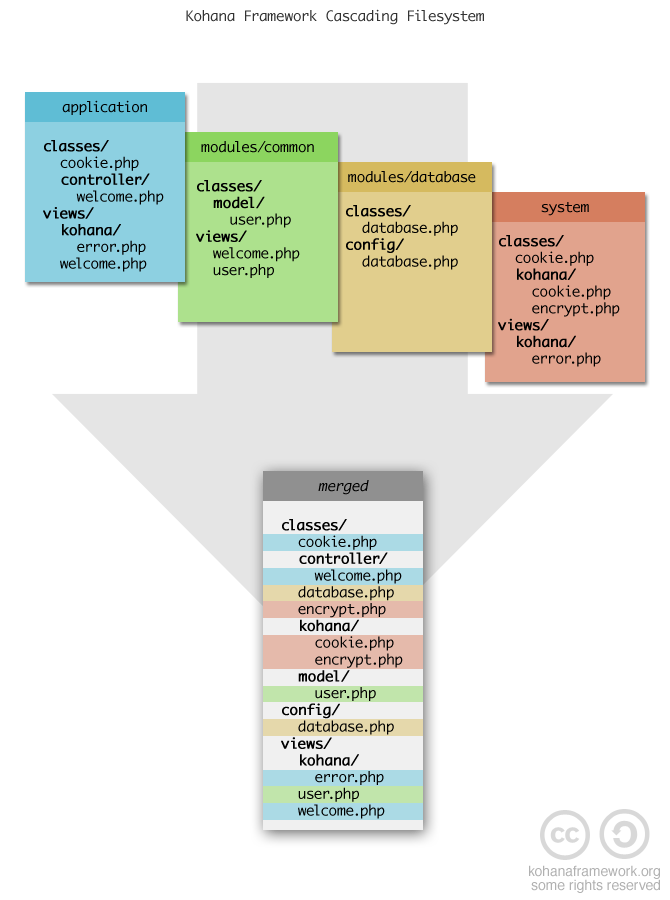

# Cascading Filesystem

The Kohana filesystem is a hierarchy of similar directory structures that cascade. The hierarchy in Kohana (used when a file is loaded by `Application::findFile()`) is in the following order:

1. **Application**
   The project's own directories (see the table below).

2. **Modules**
   Enabled with `Application::modules()` in `bootstrap/app.php`, followed by the [modules installed with Composer](modules#modules-installed-with-composer). Each is searched **in the order the modules are defined**.

3. **System**
   `SYSPATH`, the `system` directory. All the core files are defined here.

Modules and the system keep each type of file in a directory of that name (`config/`, `views/`, `messages/`, `i18n/`, `migrations/`). The application uses the project layout instead:

| Type | Application | Modules and system |
|---|---|---|
| `config` | `config/` | `config/` |
| `views` | `resources/views/` | `views/` |
| `messages` | `resources/messages/` | `messages/` |
| `i18n` | `lang/` | `i18n/` |
| `migrations` | `database/migrations/` | `migrations/` |
| any other type, e.g. `media` | `resources/media/` | `media/` |

`Application::appDirectory('views')` returns the application's directory for a type, and `Application::$appDirectories` can change it.

Files that are in directories higher up the include path order take precedence over files of the same name lower down the order, which makes it is possible to overload any file by placing a file with the same name in a "higher" directory:

This image is only shows certain files, but we can use it to illustrate some examples of the cascading filesystem:

* If Kohana catches an error, it would display the `kohana/error.php` view, So it would call `Application::findFile('views', 'kohana/error')`. This would return `resources/views/kohana/error.php` because it takes precedence over `system/views/kohana/error.php`. By doing this we can change the error view without editing the system folder.

* If we used `View::factory('welcome')` it would call `Application::findFile('views','welcome')` which would return `resources/views/welcome.php` because it takes precedence over `modules/common/views/welcome.php`. By doing this, you can overwrite things in a module without editing the modules files.

* If you used `View::factory('user')` it would call `Application::findFile('views','user')` which would return `modules/common/views/user.php`.

* If we wanted to change something in `config/database.php` we could copy the file to `config/database.php` and make the changes there. Keep in mind that [config files are merged](files/config#merge) rather than overwritten by the cascade.

## Types of Files

The cascading filesystem knows these types of files (in the application, use the directories from the table above):

classes/
:  Application classes (`App\` namespace) live in `app/`, framework and module classes in each `src/` directory. Composer [autoloads](autoloading) them by namespace; classes are not part of the cascade. File names must match the class name's case, see the [naming conventions](conventions#class-names-and-file-location).

config/
:  Configuration files return an associative array of options that can be loaded using `Application::$config`. Config files are merged rather than overwritten by the cascade. See [config files](files/config) for more information.

i18n/
:  Translation files return an associative array of strings. Translation is done using the `__()` method. To translate "Hello, world!" into Spanish, you would call `__('Hello, world!')` with `Translator::$lang` set to "es-es". I18n files are merged rather than overwritten by the cascade. See [I18n files](files/i18n) for more information.

messages/
:  Message files return an associative array of strings that can be loaded using `Application::message()`. Messages and i18n files differ in that messages are not translated, but always written in the default language and referred to by a single key. Message files are merged rather than overwritten by the cascade. See [message files](files/messages) for more information.

views/
:  Views are plain PHP files which are used to generate HTML or other output. The view file is loaded into a `View` object and assigned variables, which it then converts into an HTML fragment. Multiple views can be used within each other. See [views](mvc/views) for more information.

*other*
:  You can include any other folders in your cascading filesystem. Examples include, but are not limited to, `guide`, `vendor`, `media`, whatever you want. For example, to find `media/logo.png` in the cascading filesystem you would call `Application::findFile('media','logo','png')`.

## Finding Files

The path to any file within the filesystem can be found by calling [Kohana::find_file]:

    // Find the full path to "classes/Cookie.php"
    $path = Application::findFile('classes', 'Cookie');

    // Find the full path to "views/user/login.php"
    $path = Application::findFile('views', 'user/login');

If the file doesn't have a `.php` extension, pass the extension as the third param.

    // Find the full path to "guide/menu.md"
    $path = Application::findFile('guide', 'menu', 'md');

    // If $name is "2000-01-01-first-post" this would look for "posts/2000-01-01-first-post.textile"
    $path = Application::findFile('posts', $name, '.textile');

## Vendor Extensions

We call extensions or external libraries that are not specific to Kohana "vendor" extensions, and they go in the vendor folder, either in application or in a module. Because these libraries do not follow Kohana's file naming conventions, they cannot be autoloaded by Kohana, so you will have to manually included them. Some examples of vendor libraries are [Markdown](https://daringfireball.net/projects/markdown/), [DOMPDF](http://code.google.com/p/dompdf), [Mustache](https://github.com/bobthecow/mustache.php) and [Swiftmailer](http://swiftmailer.org/).

For example, if you wanted to use [DOMPDF](http://code.google.com/p/dompdf), you would copy it to `app/vendor/dompdf` and include the DOMPDF autoloading class. It can be useful to do this in a controller's before method, as part of a module's init.php, or the constructor of a singleton class.

    require Application::findFile('vendor', 'dompdf/dompdf/dompdf_config','inc');

Now you can use DOMPDF without loading any more files:

    $pdf = new DOMPDF;

[!!] If you want to convert views into PDFs using DOMPDF, try the [PDFView](http://github.com/shadowhand/pdfview) module.