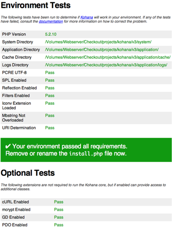
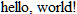

# Requirements

[!!] Before continuing, make sure you have a web server (like Apache) configured with the following requirements.

 - PHP 8.4 or newer.
 - [Iconv Extension](https://www.php.net/iconv)
 - [Character Type (CTYPE) Extension](https://www.php.net/ctype)

# Creating a Kohana Application

You can get the latest **stable** release on the [Kohana website](https://kohana.top/). This will give you a fully
functional application with an `application`, `modules`, `public`, and `system` directory.

[!!] You can find information about the file structure on the [Cascading Filesystem](files) page.

Once downloaded, you should extract the Kohana application to a directory where the web server can access it. Going
forward, we are going to assume you've extracted the application to a `kohana` directory. Then change to the `kohana`
directory and install dependencies with Composer:

~~~
composer install
~~~

# Configure

Create your environment file and generate the application keys (see [Environment Configuration](environment)):

~~~
cp .env.example .env
php public/index.php --task=key:generate
~~~

Then set your database credentials and `APP_BASE_URL` in `.env`.

Before the application can be run, you will need to make a few changes to the `app/bootstrap.php` file. This
file is the first one to be included by `public/index.php` and sets up most of the global options for the application.
Open `app/bootstrap.php` and make the following changes:

 - Set the default [timezone](https://www.php.net/timezones) for your application.
~~~
// Example of changing timezone to Sao Paulo, Brazil
date_default_timezone_set('America/Sao_Paulo');
~~~
 - The `base_url` comes from `APP_BASE_URL` in `.env`. Set it to the location of the kohana folder on your server relative to the document root, for example `APP_BASE_URL=/kohana/` when Kohana is installed at /var/www/kohana and the DocumentRoot is /var/www.

 - List your trusted hosts. Open `app/config/url.php` and add regex patterns of the hosts you expect your application to be accessible from.

   [!!] Do not forget to escape your dots (.) as these are regex patterns. These patterns should always fully match, as they are prepended with `^` and appended with `$`.
~~~
return [
    'trusted_hosts' => [
        'example\.org',
        '.*\.example\.org',
    ],
];
~~~

 - Define a salt for the `Cookie` class.
~~~
Cookie::$salt = 'some-really-long-cookie-salt-here';
~~~

 - Make sure the `app/cache` and `app/logs` directories are writable by the web server.
~~~
sudo chmod -R a+rwx app/cache
sudo chmod -R a+rwx app/logs
~~~

[!!] Make sure to use a unique salt for your application and never to share it. Take a look at the [Cookies](cookies) page for more information on how cookies work in Kohana. If you do not define a `Cookie::$salt` value, Kohana will throw an exception when it encounters any cookie on your domain.

 - Test your installation by opening [http://localhost/kohana](http://localhost/kohana).

You should see the installation page. If it reports any errors, you will need to correct them before continuing.

Once your installation page reports that your environment is set up correctly you need to either rename or delete `install.php`. Kohana is now installed, and you should see the output of the welcome controller:

